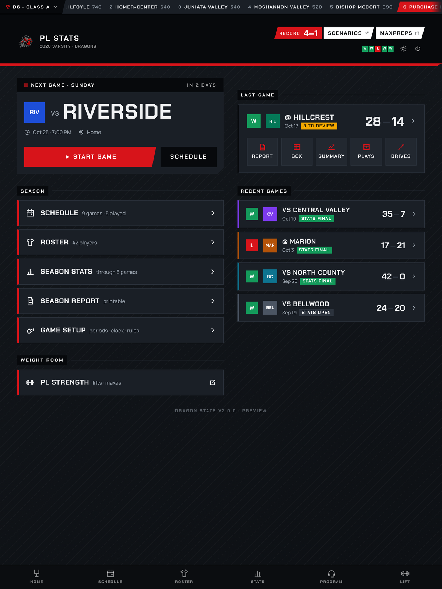
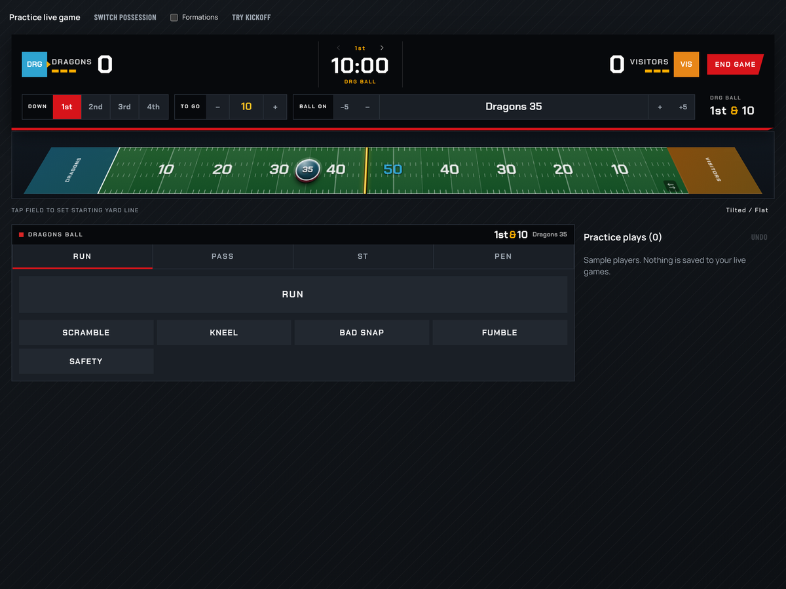
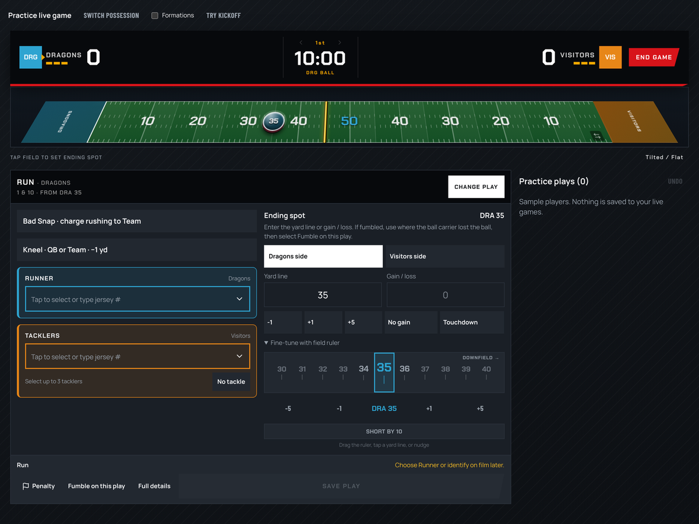
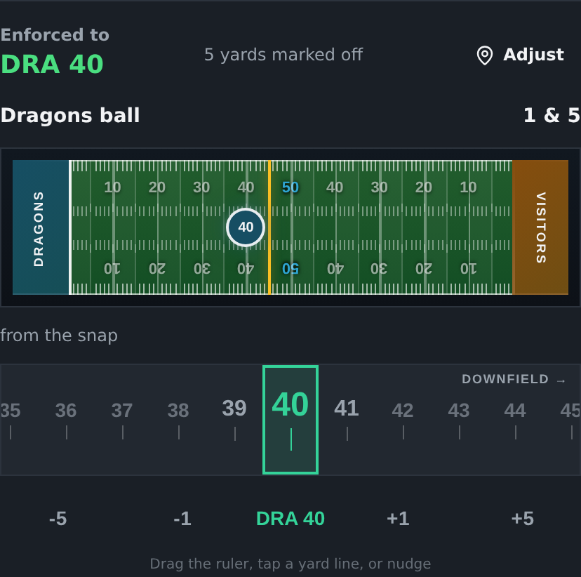
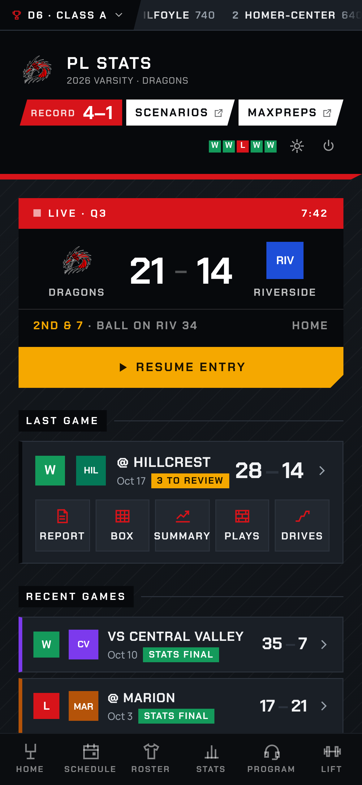
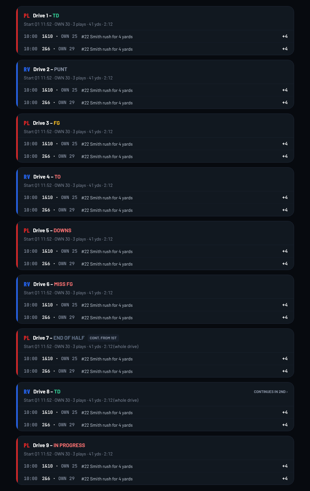
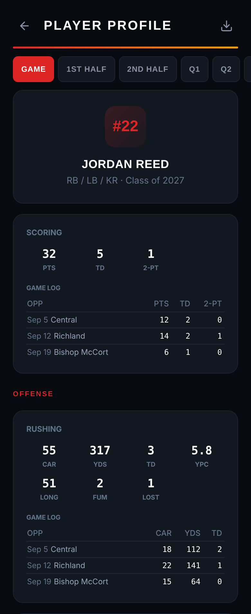
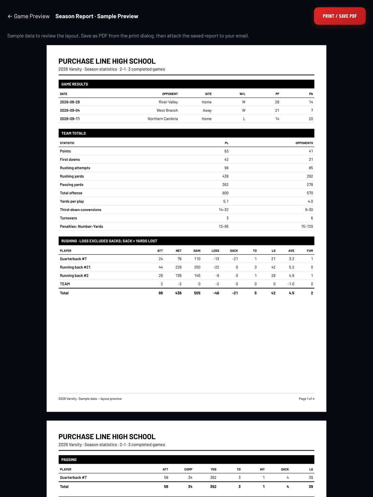
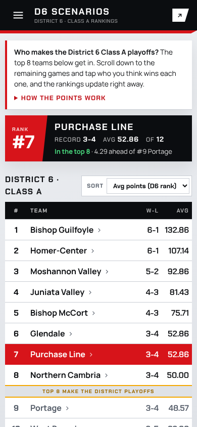
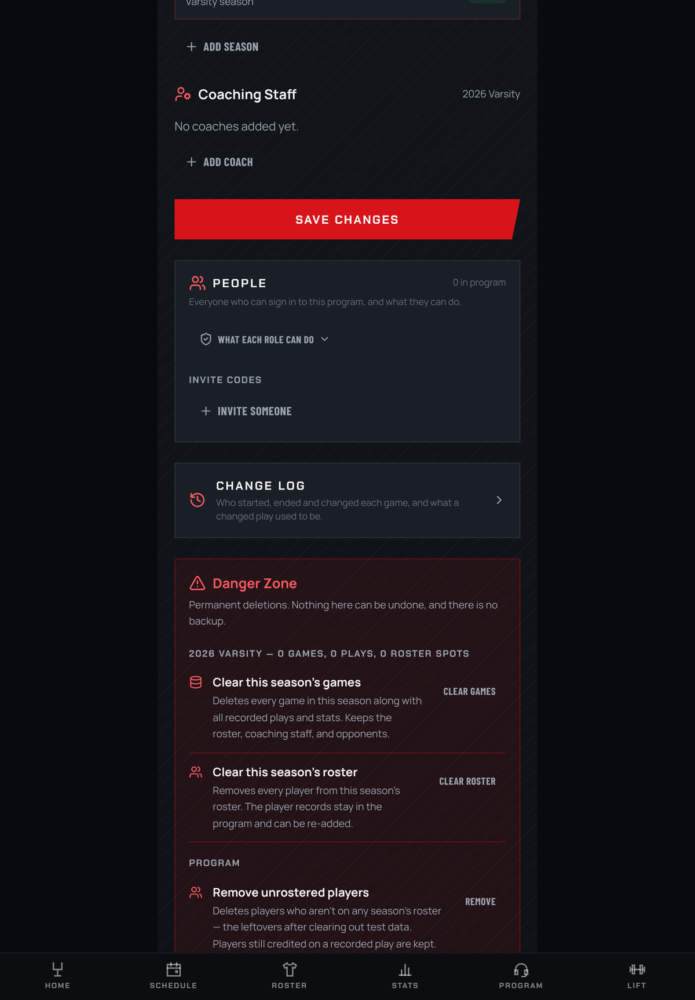

# 🐉 Dragon Stats

**Live play-by-play stats for high school football, built for one person in a press box with an iPad.**

Dragon Stats is the Purchase Line Dragons' stat book. Every snap gets recorded live, and the box score, season totals, player pages and printable reports all come straight from those plays. It replaces PressBox Stats and TurboStats with one app that runs on an iPad, a laptop or a phone.

**Live at [dragonstats.app](https://dragonstats.app)** · installs to the home screen as an app and keeps working when the press box Wi‑Fi doesn't.

<p align="center">
  
</p>

---

## What it does

### Game day

<p align="center">
  
</p>

- **Tap-to-record play entry.** Pick Run, Pass, Special Teams or Penalty, tap the field (or nudge the ruler) for the spot, and tag the players. Down, distance, spot, score and possession all follow on their own.
- **Built for speed and for crediting the right kid.** Jersey search, carried-over players shown in amber until confirmed, and a "No tackle" option so nobody gets a stat by accident.
- **Every situation the rules throw at you.** Sacks, fumbles (kept or lost), interceptions, safeties, kneels, bad snaps, onside kicks, blocked kicks, punt and kick returns (muffed, fair catch, return TD), PATs and 2-point tries.
- **Penalties done properly.** Accept or decline, enforcement spot and yardage by the NFHS rules, with a manual override when the officials see it differently.
- **Timeouts and the clock.** Team and official timeouts from the scoreboard, quarter changes and overtime.
- **Fix anything later.** Edit or delete any play from the play log and every play after it re-chains automatically. The Film Chart lets you correct spots and situations while watching film.
- **Works offline.** Plays are saved on the device first and sync to the server as soon as there's a connection, so a dropped signal never loses a snap.

<p align="center">
  
</p>

<table>
  <tr>
    <td width="50%"></td>
    <td width="50%"></td>
  </tr>
  <tr>
    <td align="center"><sub>Penalty result you can move on the field</sub></td>
    <td align="center"><sub>Live scorebug on home, with Resume Entry</sub></td>
  </tr>
</table>

### After the game

- **Game Summary, Box Score and Game Report** with full team and player stats.
- **Drive Chart** with every drive grouped by quarter and its result beside the number (TD, FG, PUNT, TO, DOWNS and more). Prints cleanly in black and white.
- **Quarter and half splits.** Switch any game report between Game, 1st Half, 2nd Half and Q1–Q4 (plus OT).
- **Bad snaps** tagged in the play log and totalled under team stats.
- **Post-game review** that flags plays to check, and a Hudl-friendly CSV export.
- **Official finals** so the record and score stay locked once a game is done.

<table>
  <tr>
    <td width="50%"></td>
    <td width="50%"></td>
  </tr>
  <tr>
    <td align="center"><sub>Drive Chart</sub></td>
    <td align="center"><sub>Player page, opened from the roster</sub></td>
  </tr>
</table>

### Season

- **Season Stats and a printable Season Report** (save as PDF from the print dialog).
- **Player pages** from the roster: scoring, offense, defense, special teams, a game log and career totals.
- **Roster import** from a CSV or a MaxPreps paste. Players carry over from season to season.
- **Home at a glance:** next game, last game with one-tap Report / Box / Summary / Plays / Drives, recent games, and a W/L box for every finished game.
- **District 6 Class A ticker** across the top of home, opening to the full power-points table.
- **Scenarios**, a link to the D6 power points simulator, so anyone can pick the remaining games and see where the Dragons land.

<table>
  <tr>
    <td width="60%"></td>
    <td width="40%"></td>
  </tr>
  <tr>
    <td align="center"><sub>Season Report</sub></td>
    <td align="center"><sub>Scenarios simulator</sub></td>
  </tr>
</table>

### Coaches and access

- **Invite-only.** Coaches join a program with an invite code; an account with no program sees nothing.
- **Four roles, enforced in the database:**

  | Role | Can do |
  | --- | --- |
  | **Admin** | Everything, including handing out any role and the Danger Zone |
  | **Head Coach** | Everything except the Danger Zone; invites and manages assistants and staff |
  | **Assistant Coach** | Record games and fix plays until a game is final, edit the roster, chart film |
  | **Staff** | See every game, report and stat (read only) |

- **People card** in the Program tab lists everyone, when they last used the app, and lets Admins and Head Coaches invite people, change a role or remove someone. "What each role can do" opens the full role chart.
- **Change log** for Admins and Head Coaches: who started or ended a game, who marked it final, and every play edit or delete with its before and after.

<p align="center">
  
</p>

---

## How it's built

| | |
| --- | --- |
| **Frontend** | React 19, TypeScript, Vite, Tailwind CSS |
| **Backend** | Supabase (Postgres, Auth, row-level security) |
| **Stats engine** | [`football-stats-engine`](packages/football-stats-engine), NFHS rules, shipped prebuilt in `packages/` |
| **App** | Installable PWA with an IndexedDB write-ahead queue for offline play entry |
| **Hosting** | GitHub Pages at dragonstats.app, deployed on every push to `main` |

A few design choices worth knowing:

- **Game state is derived, not stored.** Down, distance, spot and score are replayed from the play list every time, so editing play 12 fixes plays 13 onward.
- **A play and its player credits save together** in one database transaction (`save_play_with_players`).
- **Every write goes to the device first**, along with a note that it's owed to the server, before the network is touched.
- **Everything is scoped by program membership** through row-level security, so each team only sees its own data.

More detail for contributors is in [`CLAUDE.md`](CLAUDE.md).

## Running it locally

```bash
git clone https://github.com/nickwengle-pa/dragonstats.git
cd dragonstats
npm install
```

The stats engine is a `file:` dependency in `packages/football-stats-engine` and ships its own `dist/`, so there's nothing to build.

**Database.** With Docker running, start a local Supabase (schema from `supabase/migrations/`, mail lands in Mailpit on port 54324):

```bash
npx supabase start
npx supabase db reset   # wipe and re-seed the sandbox
```

Then point the app at it in `.env.local` (see `.env.example`):

```bash
VITE_SUPABASE_URL=http://127.0.0.1:54321
VITE_SUPABASE_ANON_KEY=<anon key printed by supabase start>
```

**Run, check and build:**

```bash
npm run dev      # http://localhost:5174
npx tsc -b       # typecheck
npm test         # rule and stat tests
npm run build    # production build + service worker
```

**Previews without signing in.** In dev, these pages render real screens from sample data: `/home-preview`, `/flow-preview` (a practice game), `/screens-preview?screen=schedule|roster|stats|program|changes`, `/pregame-preview` and `/season-report-preview`. The screenshots in this README come from them.

## Project layout

```
src/
  screens/       Home, Game, Game Summary, Box Score, Game Report, Drive Chart,
                 Season Stats, Season Report, Roster, Player, Schedule, Settings, Change Log
  components/    game/ (play entry, field, scoreboard), home/, report/, roster/, settings/
  services/      play replay, stats, penalties, offline sync, access roles, change log
supabase/
  migrations/    the database schema, one change at a time
packages/
  football-stats-engine/   prebuilt NFHS stats engine
docs/screenshots/          images for this README
```

## Deploying

A push to `main` runs the **Deploy to GitHub Pages** workflow: install, typecheck, run the tests, build, publish. Nothing ships if a test fails. An iPad that already has the app open may keep the old version until the app is closed and reopened.

---

<p align="center"><sub>Made for the Purchase Line Dragons 🐉</sub></p>
